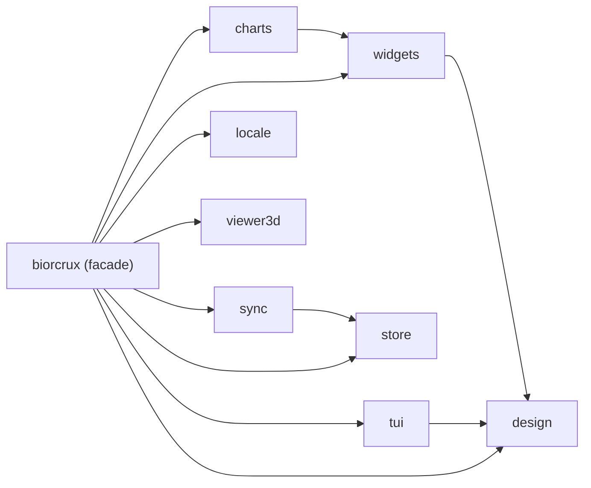

# biorcrux

Biorcrux is a modular library for building complete multiplatform Dioxus
applications. Its goal is to provide a coherent API for shared foundations such
as UI components, databases and persistence, locales, sync, design, and charts.
Maximum modularity is the primary architecture constraint: role-named packages
under `packages/` and opt-in facade features keep capabilities independently
selectable, while ports isolate platform and backend implementations. Apps use
the pieces they need without inheriting a router or backend.
`make ci-local` runs format, clippy (`-D warnings`) and tests.

## Contents

- [Use](#use)
- [App icon](#app-icon)
- [New app](#new-app)
- [Build](#build)
- [Structure](#structure)
- [Database](#database)
- [Licence and contributing](#licence-and-contributing)

## Use

```toml
biorcrux = { git = "https://github.com/grosjeanbaptiste/biorcrux", tag = "v0.0.0" }
```

```rust
rsx! { style { {biorcrux::design::STYLESHEET} } }
```

Ready-made themes: set `data-theme="ocean|forest|sunset"` on the root element. The scheme follows the system; `data-scheme="light|dark"` on any element forces it for the page. `biorcrux::design::form_factor::FormFactor` classifies a width as phone, tablet or desktop.

An app overrides a token by redefining it after the stylesheet. Tokens: `bg surface fg muted dim border accent on-accent ok warn danger`, `rem` units only.

App wording and choices belong to the app: pass them through component props or load them
from app-owned catalog files. Biorcrux presets belong in package data assets, separate from
Rust behavior. The packaged CSS and standalone HTML are data assets; implementation code
keeps only protocol, file-format, and algorithm constants, with their source documented.

Pick only what you need: `biorcrux = { …, default-features = false, features = ["design"] }`. Inject `biorcrux::widgets::STYLESHEET` after the design one.

## App icon

Every app has an icon: its own if the repo holds `assets/icon.svg|png` or `icon.svg|png`, else the BIORCRUX icon. In the app's `build.rs`:

```rust
let out = std::path::PathBuf::from(std::env::var("OUT_DIR")?);
biorcrux::design::icon::emit_png(std::path::Path::new(&std::env::var("CARGO_MANIFEST_DIR")?), &out)?;
```
For iOS, `biorcrux::design::icon::ios::emit_set` writes the 13-file `AppIcon.appiconset` (`icon_<n>x<n>.png`, the names Xcode expects). `dx bundle` writes no AppIcon entry, so without a set iOS shows a white square; a script must copy the set into the `.app` and patch `Info.plist`. An app with a master icon but no set gets an error telling it to run `scripts/make-ios-set.sh <master> <dir>`: its own icon is never replaced by the default.

then `dioxus::desktop::icon_from_memory(include_bytes!(concat!(env!("OUT_DIR"), "/app-icon.png")))` for the window, and the same file for bundles. `icon::emit` also keeps an SVG for the web favicon. A provided icon that is corrupt or unreadable fails the build; it never silently becomes the default.

## New app

`scripts/new-app.sh <name> <dir>` copies `template/`: one crate for web, desktop and mobile (features `web`, `desktop`, `mobile`), `AppShell`, icon `build.rs`, Makefile gates, `AGENTS.md`, `CONTEXT.md`, pinned to the current biorcrux tag (`BIORCRUX_TAG` overrides). Run it with `dx serve --platform web|desktop|ios|android`.

## Build

`make ci-local`

## Structure

| Package | Role |
|---|---|
| `biorcrux` | The crate apps import; one module per block, each behind a feature |
| `biorcrux-widgets` | `AppShell` (bottom bar on phones, rail on tablets, sidebar on desktops, forced with `layout`), `Badge`, `InputField`, `Table`, `Dialog`, `Stat` → `biorcrux::widgets` |
| `biorcrux-charts` | `BarChart` with pure geometry → `biorcrux::charts` |
| `biorcrux-locale` | Locales, catalogs, fallback chain, interpolation, no UI dependency → `biorcrux::locale` |
| `biorcrux-store` | Optional storage behind a `Store` port: memory, SQLite (feature `store-sqlite`), contract tests → `biorcrux::store` |
| `biorcrux-sync` | Offline-first sync: hybrid logical clock, last-write-wins, `Transport` port (feature `sync`) → `biorcrux::sync` |
| `biorcrux-design` | Tokens, reset, shared CSS (light and dark) → `biorcrux::design` |
| `biorcrux-tui` | Terminal UI: the design tokens as ratatui colours (`Palette`), ratatui re-exported (feature `tui`) → `biorcrux::tui` |

```text
biorcrux/
├── Cargo.toml            workspace, members = packages/*, Dioxus pinned once
├── Makefile              format-check, lint, test, wasm-check, wasm-test, ci-local
├── scripts/              render-icon.sh, make-ios-set.sh, new-app.sh
├── template/             multiplatform app copied by new-app.sh (not a workspace member)
└── packages/
    ├── biorcrux/           facade, features: design widgets charts locale locale-json store store-sqlite sync tui framework web desktop mobile ssr launch
    ├── biorcrux-design/    src/{lib,form_factor,icon}.rs, theme.css, themes.css, assets/ (icons)
    ├── biorcrux-widgets/   nav, shell, badge, field, table, dialog, stat, widgets.css
    ├── biorcrux-charts/    scale, bar, charts.css
    ├── biorcrux-locale/    locale, catalog, interpolate, translator
    ├── biorcrux-viewer3d/  component, page.html, viewer3d.css (glTF viewer)
    ├── biorcrux-store/     record, error, memory, sqlite, indexeddb, contract
    ├── biorcrux-sync/      clock, transport, hub, engine
    └── biorcrux-tui/       Palette read from the design CSS, ratatui re-export
```



Dependencies point one way: `widgets` → `design`, `charts` → `widgets`, `tui` → `design`, `sync` → `store`; `locale` and `store` depend on no other package.

## Database

The DB is optional (`store`). One schema for every adapter: a single table of versioned documents, no per-app tables. The app owns the meaning of `collection` and `value`.

| Field | Type | Meaning |
|---|---|---|
| `collection` | text | Name of a group of documents (`"notes"`) |
| `id` | text | Document id, unique inside its collection |
| `value` | text, nullable | Opaque payload, JSON usually. `NULL` is a tombstone (deleted, kept so the deletion syncs) |
| `stamp` | u64 | Version chosen by the caller. A `put` with a lower stamp than the stored one is ignored; equal or higher wins |

Key: `(collection, id)`. Index: `stamp`, which serves `changes_since(stamp)`. `list` hides tombstones, `changes_since` returns them.

| Adapter | Feature | Storage |
|---|---|---|
| memory | `store` | Process memory, tests |
| SQLite | `store-sqlite` | Table `records(collection, id, value, stamp)`, `PRIMARY KEY (collection, id) WITHOUT ROWID`, index `records_stamp`. `stamp` is `INTEGER`; above `i64::MAX` is an error |
| IndexedDB | `indexeddb` on `biorcrux-store` (wasm32) | Object store `records`, key path `[collection, id]`, index `stamp`. `stamp` is a 20-digit decimal string (JS numbers hold 53 bits) |

With `sync`, the stamp is a hybrid logical clock: 44 bits of milliseconds, 12 bits of counter, 8 bits of node id (256 nodes at most). Conflicts resolve last-write-wins; a clock more than 24 h ahead is refused.

## Licence and contributing

Copyright (c) Baptiste Grosjean. Public and open to contributions, under the
Apache License 2.0 (`LICENSE`): open source, commercial use allowed, on condition that
every redistribution keeps the copyright notice and the `NOTICE` file (attribution).
See `CONTRIBUTING.md` before sending code (sign-off and contributor agreement).
Tags `v0.0.6` to `v0.0.8` were published under PolyForm Noncommercial 1.0.0 and `v0.0.5`
and earlier under a proprietary notice; each stays under the licence it was published with.
